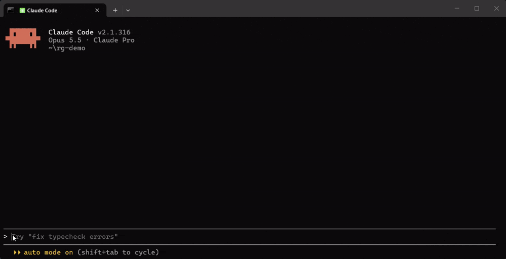

# rustgrade

**Senior Rust defaults for your coding agent, and a scanner to hold it to them.**

AI-written Rust compiles, but it often reads like tutorial Rust: `.clone()` to silence
the borrow checker, `.unwrap()` in request handlers, a std `Mutex` held across `.await`,
allocations in every loop iteration. rustgrade gives the agent better defaults, checks
the result with a deterministic scanner, and grades the crate from A to F.

**Measured, not promised:** on three tasks, 9 agent runs without rustgrade left 5
`unwrap` / `expect` calls in library code, by clippy's count. 9 runs with its edit hook
left 0, at no extra cost. It's a small sample; [the numbers and their limits](evals/agents/RESULTS-hook.md)
are public.



<sub>The agent was told to use `unwrap` here so the hook would fire. In a take without that
instruction, it wrote the `Result` on its own.</sub>

```bash
cargo binstall rustgrade            # or: cargo install --locked rustgrade
rustgrade install --agent all       # every agent detected, in this project
```

Then keep working as usual, ask for a review with `/audit`, or test code against hostile
input with `/harden`.

Works in **Claude Code, Cursor, Codex CLI, Gemini CLI, GitHub Copilot and Windsurf**,
and on its own in your terminal or CI. No LLM, no network, no account: your code stays
on your machine.

```
$ rustgrade audit
rustgrade audit: B (89), capped by 1 high finding

  Correctness & errors    80  1 high, 1 medium
  Unsafe                 n/a  no unsafe code
  Concurrency            n/a  no async, threads, locks or channels
  Performance            100  -
  Ownership & API        100  -

  Tests    1 passed, 0 failed
  Clippy   0 warning(s), pedantic
  Scanner  2 finding(s), 0 suppressed, 1 file(s), 11 lines of code
```

## What it's for

- **While an agent writes Rust.** The skill teaches it to borrow before cloning,
  return typed errors, keep channels bounded and document every `unsafe`, then to scan
  its own work before finishing.
- **While it edits, in Claude Code.** A hook scans each Rust file the agent touches and
  hands the findings back, so it fixes them even if it never loads the skill.
- **When you review Rust.** `/audit` combines the scanner, clippy and your tests into a
  grade, then adds what tools can't see: API shape, lock granularity, missing tests.
- **When input can't be trusted.** `/harden` attacks the code from where outside data
  comes in, and fixes only what a failing test demonstrates. The tests stay as proof.
- **When a function must be fast.** `/hot-path` optimizes it and proves each change with
  a benchmark.
- **In CI.** Fail a pull request on a grade or a severity, and see findings as
  code-scanning annotations.

## Where it runs

| Where | What you get | Set up with |
|---|---|---|
| Claude Code | Skill, edit hook, `/audit`, `/harden`, `/hot-path` | `--agent claude`, or the plugin below |
| Cursor | Skill, `/audit`, `/harden`, `/hot-path` | `--agent cursor` |
| Gemini CLI | Skill, `/audit`, `/harden`, `/hot-path` | `--agent gemini` |
| GitHub Copilot (VS Code) | Skill, `/audit`, `/harden`, `/hot-path` | `--agent copilot` |
| Windsurf / Devin Desktop | Skill, `/audit`, `/harden`, `/hot-path` | `--agent windsurf` |
| Codex CLI | Skill (ask for "a rustgrade audit") | `--agent codex` |
| Terminal and CI | `scan`, `audit`, `rules` | Just the CLI |

The CLI has prebuilt binaries for Linux and macOS (`x86_64`, `aarch64`) and `x86_64`
Windows. Tested end to end inside Claude Code and GitHub Copilot, both reporting the
same grade as the CLI; for the others, files are verified to land where each agent's
documentation says. Reports are welcome.

## Install

**1. The CLI**

```bash
cargo binstall rustgrade            # prebuilt binary, nothing to compile
cargo install --locked rustgrade    # or from source
```

**2. Your agent**

```bash
rustgrade install --agent all                 # every agent detected, in this project
rustgrade install --agent claude --scope user # or one agent, for all your projects
rustgrade doctor                              # check toolchain, agents and install
```

`install` copies the skill and commands, adds a hook in Claude Code that scans each Rust
file as the agent edits it (`--no-hook` skips it), and adds a short marked section to the
agent's instructions file (`CLAUDE.md`, `AGENTS.md`, `GEMINI.md` or
`.github/copilot-instructions.md`). That section matters: agents read that file on every
request but load a skill only when they decide to. In
[our evals](evals/agents/RESULTS.md) the skill was used in 0 of 6 coding runs without
it and in 6 of 6 with it.

The hook needs no such decision from the agent: the harness (Claude Code itself) runs it
on every edit. Across
[27 runs on three tasks](evals/agents/RESULTS-hook.md), medium-or-worse findings went from
6 with no help to 2 with the section and 1 with the hook; `unwrap` and `expect` counted by
clippy went from 5 to 0 with either, at no extra cost. That sample is small, and hidden
tests passed in every run with or without them: this removes what the scanner sees, it
does not prove behavior.

<details>
<summary>Claude Code plugin</summary>

Inside a Claude Code session:

```
/plugin marketplace add angeldevmobile/rustgrade
/plugin install rustgrade@rustgrade
```

Plugin commands are namespaced: `/rustgrade:audit`, `/rustgrade:harden`,
`/rustgrade:hot-path`. The plugin
brings the edit hook, which needs the CLI and stays silent without it. It does not edit
`CLAUDE.md`; to add the section too, copy the lines in
[`targets/instructions.md`](targets/instructions.md).

</details>

<details>
<summary>What install touches, and how to undo it</summary>

Every file is recorded with its hash in `~/.rustgrade/manifest.json`. `install` never
overwrites a file it didn't write or that you edited, and `uninstall` removes only its
own unedited files (both take `--force`). In instructions files rustgrade owns only the
block between `<!-- rustgrade:begin -->` and `<!-- rustgrade:end -->`, and in
`.claude/settings.json` only its hook entry.

```bash
rustgrade install --agent all --dry-run    # show what would change
rustgrade install --agent all --no-instructions   # skip the instructions section
rustgrade uninstall --agent all            # remove exactly what install wrote
```

Paths per agent live in [`targets/targets.toml`](targets/targets.toml), with links to
each agent's docs.

</details>

## Use it

**In your agent**

```
/audit [path]      graded review: scanner + clippy + tests, A to F, then judgment
/harden [path]     survive hostile input: each fix proven by a test that failed first
/hot-path <fn>     optimize a critical function, proven with a benchmark
```

`/harden` is new and lightly measured. In [7 runs on three tasks](evals/agents/RESULTS-harden.md),
all with their hidden tests already passing, it found real bugs in the 3 runs on a thread
pool, each reproduced separately, and nothing in the 4 runs on a decoder and a cache. It
doesn't find the same bugs every time. It reports what it tried and what it did not cover;
it never claims code is secure.

Or just ask: "review this crate", "why does this panic". With the section installed, the
agent also runs the scanner on Rust it writes.

**In your terminal**

```bash
rustgrade scan                        # findings for the current crate
rustgrade scan --format json          # what agents read (versioned, "schema": 1)
rustgrade audit                       # scan + clippy pedantic + tests, graded A to F
rustgrade rules --explain lock-across-await   # why a rule exists, with before/after
```

Exit codes: `0` passed, `1` threshold reached (`--fail-on`), `2` tool error.

**In CI**

```yaml
- uses: dtolnay/rust-toolchain@stable
  with: { components: clippy }
# Prebuilt static binary: seconds instead of compiling rustgrade.
- run: curl -sSfL https://github.com/angeldevmobile/rustgrade/releases/latest/download/rustgrade-x86_64-unknown-linux-musl.tar.gz | tar -xz -C ~/.cargo/bin rustgrade
- run: rustgrade audit --fail-on C    # or, cheaper: rustgrade scan --fail-on high
```

<details>
<summary>Findings as code-scanning annotations (SARIF)</summary>

```yaml
# .github/workflows/rustgrade.yml
name: rustgrade
on: [push, pull_request]
permissions:
  contents: read
  security-events: write   # upload-sarif
jobs:
  rustgrade:
    runs-on: ubuntu-latest
    steps:
      - uses: actions/checkout@v4
      - uses: dtolnay/rust-toolchain@stable
        with: { components: clippy }
      - run: curl -sSfL https://github.com/angeldevmobile/rustgrade/releases/latest/download/rustgrade-x86_64-unknown-linux-musl.tar.gz | tar -xz -C ~/.cargo/bin rustgrade
      - run: rustgrade audit --format sarif --fail-on D > rustgrade.sarif
      - uses: github/codeql-action/upload-sarif@v3
        if: always()   # upload even when --fail-on fails the step
        with: { sarif_file: rustgrade.sarif, category: rustgrade }
```

Run it from the repo root: file paths include the scan path. Inline suppressions are not
uploaded, because code scanning would open alerts for them; they stay in
`--format json` with their reason. To pin a version, replace `latest/download` with
`download/v0.5.0`.

</details>

## What it catches

| Rule | Severity | Flags |
|---|---|---|
| `unwrap-outside-tests` | high (`expect`: medium; low with a comment saying why, or on a lock) | `.unwrap()` / `.expect()` outside tests |
| `lock-across-await` | high | std / parking_lot guard alive at an `.await` |
| `undocumented-unsafe` | medium (low in tests) | `unsafe` block or impl without a `// SAFETY:` comment |
| `unbounded-channel` | medium | `unbounded_channel()`, `unbounded()`, `std::sync::mpsc::channel()` |
| `anyhow-in-lib-api` | medium | public library fn returning `anyhow` errors |
| `clone-in-loop` | medium (high in hot paths) | `.clone()` / `.to_owned()` per iteration |
| `alloc-in-loop` | medium (high in hot paths) | `Vec::new`, `format!`, `.to_string()`, ... per iteration |
| `ref-owned-param` | low | `&String`, `&Vec<T>`, `&Box<T>`, `&PathBuf` parameters |

<details>
<summary>How grades work</summary>

Areas that don't apply are left out of the average. Findings are weighed per 1000 lines
of code, so a large crate isn't graded on raw counts: one high finding per 1000 lines
caps the grade at B, two at C; a critical finding or failing tests cap it at D, and a
crate that does not compile is an F. On 15 popular crates (tokio, serde, regex, syn,
...) the scanner-only grades range from A to C: see
[evals/real-world/RESULTS.md](evals/real-world/RESULTS.md). The full rubric is in
[references/rubric.md](skills/rustgrade/references/rubric.md).

</details>

<details>
<summary>Configuration and suppressions</summary>

`rustgrade.toml` at the scan root:

```toml
allow = ["ref-owned-param"]      # disable rules project-wide
exclude = ["generated/"]         # gitignore-style globs, on top of .gitignore
hot = ["src/engine/"]            # performance findings here are raised to high
min_severity = "low"
```

A single finding is silenced inline, with a mandatory reason:

```rust
// rustgrade: allow(unbounded-channel) shutdown signal, at most one message per worker
let (stop_tx, stop_rx) = std::sync::mpsc::channel::<()>();
```

Suppressed findings stay in the JSON with their reason, so CI can audit them. Malformed
or stale suppressions are reported as findings too.

</details>

## Good to know

- **It reads syntax, not types.** Rules are heuristics: `clone-in-loop` can't tell a
  cheap `Arc` clone from a deep one, and macro bodies are not analyzed.
  `rustgrade rules --explain <id>` documents each rule's limits.
- **A clean scan is not a correctness proof.** It won't find logic bugs or races that
  don't show in the code's shape. Your tests still do that.
- **A good grade is not the goal.** A false positive gets a suppression with a reason,
  never contorted code.

## License

MIT
